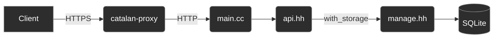

<h5 align="center">
  A stateless markdown + latex pastebin for math 📗
</h5>

<table align="center">
<tr>
<td>

```text
                                          ⡀
                  catalan  ⠈
                         ⠖⠃   ⡁     ⠐⠆      ⠁              ⡠⢔⡤⠊⠁
                  ⠁   ⠁  ⠘⠁⢀    ⢈⠓⠂⠠⡄ ⠈              ⢀⣠⣶⠿⠞⠋⠁
                     ⠒⠁ ⠠⡚⠁⢀⣙⣀⣈⡩⠬⢁ ⢑⠶⠤⡆⠤⡀      ⢀⠴⢲⣋⣽⣷⠟⠃
                ⠁ ⢠  ⣶⠃⠗⣡⣶⣮⣿⡿⠿⠿⢿⣿⣷⣶⣤⣤⠤⠴⠦⠬⣤⣤⠄⣉⠉⠝⢲⣿⡷⠻⠂
             ⠈    ⠁⡀⡸⠁⣰⣿⡿⠛⠋⣁⡀⠤⠤⢄⡀⠈⠛⢯⣿⣟⣾⣶⣶⣮⣭⣵⣾⣿⣟⠿⠉⢨⠖⠃
                ⢠ ⢠⠳⡧⣻⡿⠋⢀⠒⠉      ⠉⠢  ⠙⠛⣻⣿⣿⣿⢿⣿⣿⠟⡱⠖⠊⠁
                ⠁⢠⣧⠓⣾⣿⠁ ⠃          ⠉⢦⣠⣾⣿⠿⣿⣿⣿⡿⣫⠏⠁
               ⡀ ⠂⢃⣸⣿⠇⢠⠃         ⢀⣠⣴⣿⠟⢿⠁⠸⡿⣿⣯⡶⠃
               ⠁⢘⡄⠘⣿⣿ ⠸⡀     ⢀⣀⣴⣾⣿⡿⡟⡋⠐⡇ ⢸⣿⣿⠃ ⠁
                ⢡⠘⢰⣿⡿⡆ ⣇ ⣀⣠⣤⣶⣿⢷⢟⠻ ⠈   ⡇ ⣼⣿⣿⠂ ⡀
             ⢀⠔⢀⡴⢯⣾⠟⡏⢀⣠⣿⣿⣿⣟⢟⡋⠅⠘⠉    ⢀ ⠁⢠⣿⣟⠃ ⠁
             ⢠⠞⣻⣷⡿⢙⣩⣶⡿⠿⠛⠉⠑⢡⡁      ⢀⠔⠁ ⣰⣿⣿⡟
           ⣡⣾⣥⣾⢫⡦⠾⠛⠙⠉  ⢀⣀ ⠈⠙⠓⠦⠤⠤ ⠘⠁⢀⡤⣾⡿⠏⠁
        ⠔⣴⣾⣿⣿⢟⢝⠢⠃⢀⣤⢴⣾⣮⣷⣶⢿⣶⡤⣐⡀ ⣠⣤⢶⣪⣿⣿⡿⠟
      ⡀⣦⣾⡿⡛⠵⠺⢈⡠⠶⠿⠥⠥⡭⠉⠉⢱⡛⠻⠿⣿⣿⣿⣿⣿⠿⠿⠿⠟⠭⠛⠂
   ⢀⢴⠕⣋⠝⠕⠐ ⠔⠉    ⠁         ⠉⠁⠉⠁⠁⠁⠁⠈ ⠁
⢀⣠⠁⠈
```
</td>
</tr>
</table>

> Licensed under the Apache License v2, see details [here](#license).

* API reference: [here](openapi.yaml)
* Original project: [mathb](https://github.com/susam/mathb)


## Overview

Catalan is a pastebin for math via Markdown and LaTeX. It's my own version of [mathb](https://github.com/susam/mathb), the now discontinued math pastebin in PHP.

The backend is a single C++20 binary built on [Crow](https://crowcpp.org) and [sqlite_orm](https://github.com/fnc12/sqlite_orm), with posts stored in SQLite. It ships as a small Docker image for Linux `amd64` or `arm64`, and the image can be built from a Mac or Linux machine.

**Catalan is in early development**. The API below is planned and not final.

A request passes through 3 layers:

* [Caddy](https://caddyserver.com) as a reverse proxy, for HTTPS, rate limiting, and request size limits
    * See details [here](#deployment)
* The Crow routes in `main.cc` and `api.hh` - request validation, post ids, and the JSON shapes in the [OpenAPI spec](openapi.yaml)
    * See details [here](#api)
* SQLite storage in `manage.hh` via sqlite_orm - the schema, versioned migrations, and queries behind a single connection



## Features

* **Markdown with inline and display LaTeX**
* Posts are immutable, and every edit is a new post with its own link
* Editing a post creates a new post, with a `parent_id` pointing at the original
* Unlisted posts are left out of the listing, but readable by anyone with the link
* Stateless, with no accounts, sessions, or cookies

---

## API

> 📖 [See the OpenAPI spec here](openapi.yaml) (draft)

* **Posts are immutable** - Since posts are stateless, no one can change or delete a post through the API. "Editing" is creating a new post with a `parent_id`, and an operator can remove a post, see [Removing a post](#removing-a-post)
* **Unlisted, not private** - Post ids are random 12-character base62 strings (`0-9`, `a-z`, `A-Z`)

Endpoints:

* `POST /v1/posts` - create a post, or an edit of one with `parent_id`
* `GET /v1/posts` - list posts, newest first, with `limit`, `order`, and `cursor`
* `GET /v1/posts/{id}` - get a post
* `GET /v1/posts/{id}/raw` - get a post's source as plain text
* `GET /health` - `200 ok` when the database is reachable, `503` when it isn't

A new post:

* `body` - Markdown and LaTeX source, required
* `title` - optional, up to 200 characters
* `author` - optional display name, up to 64 characters, not verified
* `unlisted` - leave it out of `GET /v1/posts`, `false` by default
* `parent_id` - the post this one is an edit of

The server sets `id` and `created_at`.

### Idempotency-Key

`POST /v1/posts` isn't idempotent: sending it twice creates two posts. If a connection drops after the server creates a post but before the `201` arrives, a client can't tell whether to retry. An `Idempotency-Key` makes the retry safe:

```bash
KEY="\"$(uuidgen)\""    # one key per post, reused on every retry

curl -i http://localhost:18080/v1/posts \
  -H 'Content-Type: application/json' \
  -H "Idempotency-Key: $KEY" \
  -d '{ "body": "$$e^{i\\pi} + 1 = 0$$" }'

# HTTP/1.1 201 Created
# Location: /v1/posts/7HcPq2mVa0Rn
```

Running it again with the same key returns the same post instead of a new one:

```
HTTP/1.1 201 Created
Location: /v1/posts/7HcPq2mVa0Rn
Idempotent-Replayed: true
```

* The same key with a different post is a `422`, with type `/problems/idempotency-key-reused`
* Keys are kept for 24 hours, and must be 16 to 255 visible ASCII characters
* **Note**: There is no auth, so keys aren't scoped to a client - use a random UUID, never a guessable value

### Status codes

Errors are returned as [RFC 9457 Problem Details](https://www.rfc-editor.org/rfc/rfc9457) (`application/problem+json`), so every error has the same shape:

```json
{
  "type": "/problems/validation",
  "title": "Validation failed",
  "status": 422,
  "detail": "The request body has 2 invalid fields.",
  "errors": [
    { "field": "body", "message": "must not be empty" },
    { "field": "parent_id", "message": "no post with id 4fQx9ZtLb2Wk" }
  ]
}
```

---

## Requirements

* Docker Desktop on macOS, Docker Engine 23+ on Linux
* For native builds: CMake 3.16+, a C++20 compiler, SQLite3 headers, and git

Dependencies are fetched by [CPM](https://github.com/cpm-cmake/CPM.cmake) on the first configure and cached in `~/.cache/CPM`. Set `CPM_SOURCE_CACHE` to change the location.

## Development

There are two ways to develop: inside the dev container, which matches production, or natively on your machine.

### Dev container

The dev container is Debian at your machine's native architecture, `arm64` on Apple Silicon and `amd64` on most Linux machines. There is no emulation, so builds run at full speed and sanitizers work:

```bash
docker compose up -d --build          # build the toolchain image and start it
docker compose exec dev bash          # shell in /workspace

# inside the container:
cmake -B build -DCMAKE_BUILD_TYPE=Debug -DUSE_SANITIZER="Address;Undefined"
cmake --build build -j
./build/test_suite
./build/catalan                       # http://localhost:18080/health
```

The source tree is bind-mounted, so edit on the host and rebuild in the container. The container's `build/` is a Docker volume, i.e. separate from a host `build/`.

To develop on x86_64 from Apple Silicon, run the container under emulation. It is slower, and AddressSanitizer may not work:

```bash
docker compose down -v                # drop the arm64 build volume first
DOCKER_DEFAULT_PLATFORM=linux/amd64 docker compose up -d --build
```

`docker compose down` stops the container, add `-v` to also delete the build and CPM cache volumes.

### Native

```bash
# macOS
brew install cmake sqlite

# Ubuntu
sudo apt install build-essential cmake git libsqlite3-dev
```

```bash
cmake -B build -DCMAKE_BUILD_TYPE=Debug -DUSE_SANITIZER="Address;Undefined"
cmake --build build -j
./build/test_suite
./build/catalan
```

I personally **do not** recommend developing without at least `Address;Undefined`.

**Note**: The pre-commit `clang-tidy` hook reads `build/compile_commands.json`, so configure a native `build/` even if you develop in the dev container - the container's `build/` is a separate volume.

#### CMake options

* `CMAKE_BUILD_TYPE` - `Release` by default, `Debug` adds `-DDEBUG` and debug info
* `USE_SANITIZER` - e.g. `Address;Undefined` or `Thread`
* `CATALAN_BUILD_TESTS` - build `test_suite` and register it with CTest, `ON` by default

---

## Cross-compiling

The `builder` stage of the `Dockerfile` always runs on the build machine's native architecture and cross-compiles with Debian's GCC cross toolchain (`crossbuild-essential-<arch>`) and multiarch `libsqlite3-dev:<arch>`. There is no QEMU involved, so an `amd64` build from an M-series Mac compiles at native speed.

Build a Linux binary without an image:

```bash
docker buildx build --platform linux/amd64 --target artifact --output type=local,dest=dist .
file dist/catalan    # ELF 64-bit LSB pie executable, x86-64 ...
```

The binary links dynamically against glibc, libstdc++, and libsqlite3 from Debian trixie - run it on a matching or newer distro, or use the image.

To cross-compile without Docker on a Debian/Ubuntu host, use a toolchain file from `cmake/toolchains/`:

```bash
sudo dpkg --add-architecture arm64 && sudo apt update
sudo apt install crossbuild-essential-arm64 libsqlite3-dev:arm64

cmake -B build-arm64 -DCMAKE_TOOLCHAIN_FILE=cmake/toolchains/linux-arm64.cmake \
      -DCMAKE_BUILD_TYPE=Release -DCATALAN_BUILD_TESTS=OFF
cmake --build build-arm64 -j
```

**Note**: When cross-compiling, `test_suite` still builds but doctest's test discovery is skipped, since the host can't run it. Copy it to a matching machine to run it, or pass `-DCATALAN_BUILD_TESTS=OFF`.

---

## Deployment

Production is two containers on a private Docker network:

* **catalan** - the API: `debian:trixie-slim` with `libsqlite3-0` and the stripped binary, running as an unprivileged `catalan` user (uid 10001) with the database in the `/data` volume. Never published to the host.
* **catalan-proxy** - [Caddy](https://caddyserver.com) with the [rate limit plugin](https://github.com/mholt/caddy-ratelimit), built from the `proxy` stage. The only container on ports 80 and 443. Configured in [deploy/Caddyfile](deploy/Caddyfile).

The proxy handles everything else:

* HTTPS - certificates from Let's Encrypt, issued and renewed automatically
* Rate limiting - 60 requests per minute per client IP, `429` with `Retry-After`
* Body size - requests over 256 KiB get `413` before they reach the API
* Compression - `zstd` and `gzip`

The proxy holds the TLS certificates and almost never changes, the API is redeployed often, and each container runs one process.

Environment variables:

* `CATALAN_PORT` (catalan) - HTTP listen port, `18080` by default
* `CATALAN_DB` (catalan) - SQLite database path, `catalan.db` by default, i.e. `/data/catalan.db` in the volume
* `CATALAN_DOMAIN` (proxy) - your domain for HTTPS, e.g. `api.example.com`. Unset, the proxy serves plain HTTP on `:80`
* `CATALAN_UPSTREAM` (proxy) - API address, `catalan:18080` by default

### 1. Build and test locally

```bash
docker compose --profile prod up -d --build proxy   # starts catalan too
curl localhost:18081/health           # ok - through the proxy, APP_PORT overrides 18081
docker compose --profile prod rm -sf proxy catalan  # leaves the dev container running
```

### 2. Build and push both images for the server's architecture

```bash
export IMAGE=ghcr.io/<you>/catalan    # or Docker Hub, ECR, etc.
export TAG=$(git rev-parse --short HEAD)

docker login ghcr.io                  # once per machine

# linux/amd64, linux/arm64, or both
docker buildx build --platform linux/amd64 \
  -t "$IMAGE:$TAG" -t "$IMAGE:latest" --push .

docker buildx build --platform linux/amd64 --target proxy \
  -t "$IMAGE-proxy:$TAG" -t "$IMAGE-proxy:latest" --push .
```

For a multi-arch image pass `--platform linux/amd64,linux/arm64`. Docker Desktop handles this out of the box. On Docker Engine without the containerd image store, run `docker buildx create --use` once to switch to a `docker-container` builder.

### 3. Run on the server

You need a domain for HTTPS. Point its DNS `A`/`AAAA` record at the server and open ports 80 and 443 first - Let's Encrypt needs both to issue the certificate.

Once, on a new server:

```bash
docker network create catalan
```

Set your domain for the commands below:

```bash
export CATALAN_DOMAIN=api.example.com    # your domain
```

The API:

```bash
docker pull "$IMAGE:$TAG"

docker rm -f catalan 2>/dev/null || true
docker run -d --name catalan \
  --network catalan \
  --restart unless-stopped \
  -v catalan-data:/data \
  "$IMAGE:$TAG"
```

The proxy, only when it's new or `deploy/Caddyfile` changed:

```bash
docker pull "$IMAGE-proxy:$TAG"

docker rm -f catalan-proxy 2>/dev/null || true
docker run -d --name catalan-proxy \
  --network catalan \
  --restart unless-stopped \
  -p 80:80 -p 443:443 -p 443:443/udp \
  -e CATALAN_DOMAIN \
  -v caddy-data:/data \
  -v caddy-config:/config \
  "$IMAGE-proxy:$TAG"
```

```bash
docker logs -f catalan-proxy          # watch the certificate get issued
curl -fsS "https://$CATALAN_DOMAIN/health"
```

`catalan-data` holds the SQLite database and `caddy-data` holds the certificates, both survive container replacement. **Don't delete `caddy-data`** - Let's Encrypt rate limits certificate issuance, and losing it means re-issuing. To use a host directory for the database instead (`-v /srv/catalan:/data`), make it writable by the container user first with `sudo chown 10001:10001 /srv/catalan`.

A routine deploy is only the API block. Requests fail for the second or two while the container restarts.

To roll back, re-run the API block with an earlier `$TAG`.

#### Note: Without a registry, the images can be copied over SSH:

```bash
docker buildx build --platform linux/amd64 -t catalan:$TAG --load .
docker buildx build --platform linux/amd64 --target proxy -t catalan-proxy:$TAG --load .
docker save catalan:$TAG catalan-proxy:$TAG | gzip | ssh user@server 'gunzip | docker load'
# then run step 3 on the server with catalan:$TAG and catalan-proxy:$TAG
```

### Removing a post

The API has no way to delete a post. For abuse or illegal content, the operator CLI in `admin/` removes posts directly from the database, alongside the running server. It's built from the `admin` stage, with the same uid as the server so SQLite's files stay owned by it:

```bash
docker buildx build --platform linux/amd64 --target admin \
  -t "$IMAGE-admin:$TAG" --push .

# on the server
docker run --rm -it -v catalan-data:/data "$IMAGE-admin:$TAG" show <id>
docker run --rm -it -v catalan-data:/data "$IMAGE-admin:$TAG" remove <id>
```

`show` prints the post and every edit of it, and `remove` asks for confirmation (`--yes` skips it). A post with edits isn't removed unless you pass `--with-edits`, which also removes the edits of its edits.

A removed post returns `404` right away, including to clients revalidating with its `ETag`. Browsers may keep showing a copy they already cached for up to a day (`Cache-Control: max-age=86400`), and nothing can recall a copy someone saved.

To work on the CLI itself:

```bash
cd admin
poetry install
make test                                      # mypy, flake8, then pytest
poetry run python -m catalan_admin --db ../catalan.db show <id>
```

## Dependencies

Dependencies are fetched automatically via [CPM](https://github.com/cpm-cmake/CPM.cmake).

* [`Crow`](https://crowcpp.org) - HTTP and routing
* [`asio`](https://think-async.com/Asio/) - Networking for Crow, standalone (no Boost)
* [`sqlite_orm`](https://github.com/fnc12/sqlite_orm) - SQLite ORM
* [`doctest`](https://github.com/doctest/doctest) - Test framework
* [`cmake-scripts`](https://github.com/StableCoder/cmake-scripts) - Sanitizer and tooling integration

The operator CLI in `admin/` uses only the Python standard library. Its development tools (`mypy`, `flake8`, `black`, `pytest`) are managed by [Poetry](https://python-poetry.org).

## License

Apache License, Version 2.0. See [LICENSE](LICENSE).
